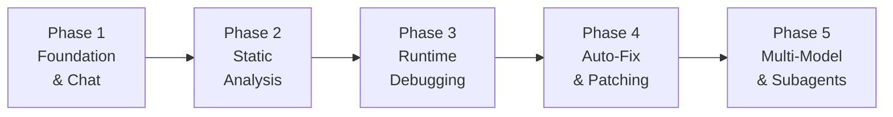

# CodeMedic — AI Debugging Agent (CLI)

A vertical AI agent built in Java whose primary task is debugging codebases. It will start as a CLI tool powered by Anthropic's Claude API and evolve into a multi-model, multi-agent system.

## High-Level Roadmap




| Phase | Focus                             | Key Outcome                             |
| ----- | --------------------------------- | --------------------------------------- |
| **1** | Project setup, CLI, Anthropic API | Chat with Claude about code files       |
| **2** | Code parsing, pattern detection   | Scan a codebase and find bugs           |
| **3** | Log/stack trace analysis          | Paste an error, get root cause          |
| **4** | Diff generation, auto-patching    | Agent suggests and applies fixes        |
| **5** | Ollama, subagent orchestration    | Multiple specialized agents collaborate |


> [!IMPORTANT]
> **We will implement Phase 1 first.** The remaining phases are outlined for vision — we'll plan each one in detail when we get there.

---


## Phase 1: Foundation & Chat (Current Focus)


### Goal

Build a working CLI tool that can:

1. Accept an Anthropic API key (via config or environment variable)
2. Read source code files from disk
3. Send them to Claude with a debugging-focused system prompt
4. Stream Claude's response back to the terminal in real-time
5. Support an interactive chat loop for follow-up questions


### Tech Stack


| Component         | Library                        | Why                                                                     |
| ----------------- | ------------------------------ | ----------------------------------------------------------------------- |
| Build tool        | **Gradle** (Kotlin DSL)        | Modern, fast, great dependency management                               |
| Java version      | **Java 21** (LTS)              | Latest LTS with modern features (records, text blocks, virtual threads) |
| CLI framework     | **Picocli**                    | Best-in-class Java CLI — annotation-driven, auto-help, subcommands      |
| HTTP client       | **Java HttpClient** (built-in) | No extra deps, supports streaming (SSE)                                 |
| JSON parsing      | **Jackson**                    | Industry standard, fast, flexible                                       |
| Terminal colors   | **JansiConsole via Picocli**   | ANSI colors and formatting for rich output                              |
| Config management | **HOCON (Typesafe Config)**    | Human-friendly config files, supports env var substitution              |
| Logging           | **SLF4J + Logback**            | Standard Java logging                                                   |


### Project Structure

```
codemedic/
├── build.gradle.kts              # Gradle build config
├── settings.gradle.kts           # Project settings
├── gradle/
│   └── wrapper/                  # Gradle wrapper (no install needed)
├── src/
│   ├── main/
│   │   ├── java/
│   │   │   └── dev/codemedic/
│   │   │       ├── CodeMedicApp.java        # Entry point + Picocli root command
│   │   │       ├── cli/
│   │   │       │   ├── AnalyzeCommand.java  # `codemedic analyze <file>`
│   │   │       │   ├── ChatCommand.java     # `codemedic chat` (interactive)
│   │   │       │   └── ConfigCommand.java   # `codemedic config set-key`
│   │   │       ├── llm/
│   │   │       │   ├── LlmProvider.java     # Interface (swap models later)
│   │   │       │   ├── LlmRequest.java      # Request model
│   │   │       │   ├── LlmResponse.java     # Response model
│   │   │       │   └── AnthropicProvider.java # Claude API implementation
│   │   │       ├── core/
│   │   │       │   ├── FileLoader.java      # Read source files from disk
│   │   │       │   ├── ContextBuilder.java  # Build prompts with code context
│   │   │       │   └── DebugSession.java    # Manages conversation state
│   │   │       ├── config/
│   │   │       │   └── AppConfig.java       # Load/save config + API keys
│   │   │       └── output/
│   │   │           └── TerminalRenderer.java # Colored, formatted terminal output
│   │   └── resources/
│   │       ├── application.conf             # Default HOCON config
│   │       └── system-prompts/
│   │           └── debugger.txt             # The debugging system prompt
│   └── test/
│       └── java/
│           └── dev/codemedic/
│               ├── llm/
│               │   └── AnthropicProviderTest.java
│               └── core/
│                   └── FileLoaderTest.java
└── README.md
```


### Proposed Changes (Phase 1)

---


#### Build & Configuration


##### [NEW] `build.gradle.kts`

- Gradle Kotlin DSL build file
- Java 21 toolchain
- Dependencies: Picocli, Jackson, Typesafe Config, SLF4J + Logback
- Application plugin for creating a runnable distribution (`./codemedic`)
- GraalVM Native Image plugin (optional, for future single-binary distribution)


##### [NEW] `settings.gradle.kts`

- Root project name: `codemedic`


##### [NEW] `src/main/resources/application.conf`

- HOCON config with defaults for:
  - `codemedic.llm.provider = "anthropic"`
  - `codemedic.llm.model = "claude-sonnet-4-20250514"`
  - `codemedic.llm.api-key = ${?ANTHROPIC_API_KEY}` (reads from env var)
  - `codemedic.llm.max-tokens = 4096`
  - `codemedic.debug.verbose = false`

---


#### LLM Provider Layer


##### [NEW] `LlmProvider.java`

- **Interface** with methods:
  - `LlmResponse analyze(LlmRequest request)` — single request/response
  - `void analyzeStreaming(LlmRequest request, Consumer<String> onToken)` — streaming
- This interface is the **key extensibility point** — Phase 5 adds `OllamaProvider`, etc.


##### [NEW] `LlmRequest.java` / `LlmResponse.java`

- Java **records** modeling the request (system prompt, messages, model, max tokens) and response (content, usage stats, stop reason)


##### [NEW] `AnthropicProvider.java`

- Implements `LlmProvider`
- Uses `java.net.http.HttpClient` to call `https://api.anthropic.com/v1/messages`
- Handles Anthropic-specific headers (`x-api-key`, `anthropic-version`)
- Parses SSE stream for real-time token output
- Error handling for rate limits, auth failures, network errors

---


#### CLI Layer


##### [NEW] `CodeMedicApp.java`

- Picocli `@Command` root class with `main()`
- Registers subcommands: `analyze`, `chat`, `config`
- Global options: `--verbose`, `--model`, `--no-color`
- ASCII art banner on startup


##### [NEW] `AnalyzeCommand.java`

- `codemedic analyze <file-or-directory> [--focus "null pointer"] [--depth 3]`
- Reads file(s), builds context, sends to LLM, streams response
- Supports single file or recursive directory scan (with `.gitignore` respect)


##### [NEW] `ChatCommand.java`

- `codemedic chat [--file <file>]`
- Interactive REPL loop with conversation history
- Special commands: `/file <path>` (add file to context), `/clear`, `/exit`
- Maintains `DebugSession` with full message history


##### [NEW] `ConfigCommand.java`

- `codemedic config set-key <api-key>` — saves API key to `~/.codemedic/config`
- `codemedic config show` — displays current config (key masked)
- `codemedic config set <key> <value>` — set any config value

---


#### Core Logic


##### [NEW] `FileLoader.java`

- Reads files from disk with encoding detection
- Respects `.gitignore` patterns
- Supports glob patterns (`*.java`, `src/**/*.py`)
- Returns structured `CodeFile` records (path, language, content, line count)


##### [NEW] `ContextBuilder.java`

- Builds the LLM prompt by combining:
  - System prompt (from `debugger.txt`)
  - Code files with clear delimiters and line numbers
  - User's question or focus area
- Manages token budget (truncates large files intelligently)


##### [NEW] `DebugSession.java`

- Holds conversation history (list of messages)
- Tracks which files are in context
- Provides `addUserMessage()`, `addAssistantMessage()`, `getMessages()`

---


#### Output & UX


##### [NEW] `TerminalRenderer.java`

- ANSI-colored output (errors in red, suggestions in green, code in cyan)
- Markdown-lite rendering (bold, headers, code blocks)
- Streaming display (tokens appear as they arrive)
- Spinner/progress indicator during API calls


##### [NEW] `src/main/resources/system-prompts/debugger.txt`

- Carefully crafted system prompt that makes Claude behave as a debugging specialist:
  - Analyze code for bugs, logic errors, edge cases
  - Explain root causes clearly
  - Suggest specific fixes with code
  - Ask clarifying questions when the problem is ambiguous
  - Consider performance, security, and maintainability

---


### Example Usage (After Phase 1)

```bash
# Set your API key
$ codemedic config set-key sk-ant-...

# Analyze a single file
$ codemedic analyze src/Main.java
🔍 Analyzing src/Main.java...

Found 3 potential issues:

  1. ⚠️  NullPointerException risk (line 42)
     userProfile.getName() is called without null check.
     The getUserProfile() method returns null when user is not found.
     
     Fix:
     ```java
     if (userProfile != null) {
         String name = userProfile.getName();
     }
     ```

  2. 🐛 Off-by-one error (line 78)
     ...

# Interactive debugging chat
$ codemedic chat --file src/Main.java
🩺 CodeMedic Debug Session
   File loaded: src/Main.java (142 lines)
   Type your question, or /help for commands.

> Why does this crash when the input list is empty?
🤖 Looking at your code...

The crash occurs because on line 23, you call `list.get(0)` 
without checking if the list is empty first...

> /file src/Utils.java
📎 Added src/Utils.java to context (89 lines)

> Could the issue also be in the utility method?
🤖 Yes! Looking at Utils.java alongside Main.java...
```

---


## Open Questions

> [!IMPORTANT]
> **Project naming**: I've used `codemedic` as a working name. Would you prefer a different name?

> [!IMPORTANT]
> **Java version**: Do you have Java 21 installed? If not, we can use Java 17 (also LTS) — the code differences are minor. Run `java -version` to check.

> [!IMPORTANT]
> **Gradle vs Maven**: I've chosen Gradle for its speed and modern Kotlin DSL. Are you comfortable with Gradle, or would you prefer Maven (XML-based, more traditional)?

> [!IMPORTANT]
> **Anthropic API Key**: Do you already have an Anthropic API key? If not, you'll need to sign up at [console.anthropic.com](https://console.anthropic.com) to test the tool.

> [!IMPORTANT]
> **Package name**: I've used `dev.codemedic` as the Java package. Would you prefer a different root package (e.g., `com.yourgithub.codemedic`)?

---


## Verification Plan


### Automated Tests

- Unit tests for `FileLoader` (reads files, respects gitignore)
- Unit tests for `ContextBuilder` (builds correct prompts, handles token limits)
- Integration test for `AnthropicProvider` (mocked HTTP responses)
- CLI smoke test: `codemedic --help` outputs usage info


### Manual Verification

- Run `codemedic analyze` on a sample Java file with known bugs
- Run `codemedic chat` and have a multi-turn debugging conversation
- Verify streaming output appears token-by-token
- Test error handling (no API key, invalid file, network failure)

---


## Future Phases (High-Level)


### Phase 2: Static Analysis

- Java AST parsing (JavaParser library)
- Pattern-based bug detection (common anti-patterns)
- Combine LLM insights with static analysis results


### Phase 3: Runtime Debugging

- Stack trace parser (extracts file, line, method, exception)
- Log file analyzer (pattern recognition, anomaly detection)
- `codemedic diagnose <stacktrace.txt>` command


### Phase 4: Auto-Fix & Patching

- Unified diff generation
- `codemedic fix <file> --apply` to auto-patch
- Git integration (create fix branches)


### Phase 5: Multi-Model & Subagents

- `OllamaProvider` for local models
- `OpenAIProvider`, `GeminiProvider`
- Subagent orchestration (specialized agents for different tasks)
- Agent routing (pick the best model for each debugging subtask)
